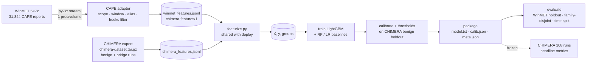
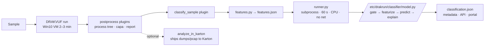

# CHIMERA classifier: dataset choice, architecture, project plan

Status: 23 Oct 2026 (Fri). Deadlines from the brief: first `model.py` **Sun 25 Oct**, final model and metrics **Wed 28 Oct**.
The dataset choice was due 22 Oct, so send §6 to Shreyas today.

---

## 1. Decision (tl;dr)

| Question | Answer |
|---|---|
| Training data for the **malicious** class | **WinMET (the MALVADA dataset)**: 31,844 CAPEv2 reports, converted into CHIMERA's own `chimera-features/1` format |
| Training data for the **benign** class | **CHIMERA's own benign runs** (about 60 exist now; ask for a larger batch). None of the three public datasets has usable benign data |
| Model | **LightGBM** gradient-boosted trees on tabular features. Random Forest and logistic regression as baselines. **No LSTM in the shipped model**; an LSTM is at most an ablation for the paper |
| Second output | Family prediction (LightGBM multiclass on the top WinMET families), returned only when confident |
| Don't use | Oliveira (Kaggle) and ocatak/Mal-API: their API calls are stored as integers with no name mapping, so they can't be matched to `hooks.txt` |

---

## 2. What CHIMERA's telemetry looks like (measured, not assumed)

I ran the real extractor (`drakrun/analyzer/classifier/features.py` from `origin/sprint/final`) on the sample run
`96f7ee81-…` (BGInfo64, benign). The output is saved as `fixtures/bginfo-96f7ee81-features.json`.

- `api_calls`: **12 distinct APIs, 227 calls** in the sample's process tree (15 distinct / 610 across all processes).
  The vocabulary is narrow: only the **262 APIs in `hooks.txt`** can ever appear.
- `api_sequence` keeps repeats (e.g. 18× `LdrGetDllHandle` in a row) and is capped at 2,000.
- `files` / `registry` counters come from `filetracer` / `regmon`, which log the **NT syscalls**
  (`NtCreateFile`, `NtWriteFile`, `NtSetValueKey`, …). These are a second channel next to `api_calls`.
- `ttps` come from **capa** rules run on DRAKVUF output (here: T1012, T1129).
- `run.complete = false` and `run.vm_stalled = true` on this ordinary benign run (one 20 s stall).
  **So "return unknown when `complete` is false" would discard normal runs.** Gate on "too little behaviour"
  instead, and mention a stall in the explanation (see §4.4).
- Paths contain the guest user name (`C:\Users\Shreyas\…`). Path strings must never become features.

## 3. Dataset comparison

| | WinMET / MALVADA | Oliveira 2019 (Kaggle CSV) | ocatak LSTM repo (= Mal-API-2019) |
|---|---|---|---|
| Size | 31,844 reports, 13 GB compressed, **~750 GB unpacked** | 43,876 rows: 42,797 malware / **1,079 goodware** | 7,107 malware, **0 benign** |
| Sandbox | CAPEv2, 2024 | Cuckoo, 2019 | Cuckoo, 2018 |
| API names usable? | **Yes**, real Windows names | **No**: integers 0–306, mapping not included | **No**: integers, mapping not included |
| Overlap with `hooks.txt` | 133 of 262 hooks seen in just 40 reports; median 26 hooked APIs per report | can't be measured | can't be measured |
| Sequence | full call stream per process, with timestamps and `repeated` counts | first 100 *distinct* calls | full sequence, integer-coded |
| Files / registry / process tree | yes (NT calls + `summary` + `processtree`) | no | no |
| Network | **stripped** (`network` is empty); network *APIs* are still in the call stream | no | no |
| Labels | AVClass + CAPE family per report (1,052 families; e.g. Redline 4,438, Vbclone 4,023, Berbew 2,794, AgentTesla 1,201) | binary | 8 coarse AV types (Trojan, Worm, …) |
| Fit for CHIMERA | **Best**: can be converted to `chimera-features/1` | Poor | Not for malicious vs benign |

Why WinMET wins: it is the only dataset whose raw behaviour can be turned into exactly what CHIMERA's model will
receive. The same feature code can then run on both sides, which the panel will ask about.
Its two gaps are **no benign class** and **no network/TTP blocks**; the plan below handles both.

WinMET notes: the 7z volumes use AES (password `infected`, as stated on Zenodo), which macOS `bsdtar` can't open.
`py7zr` can, and it can stream reports into memory: measured **166 MB/s, about 7.7 reports/s** per process, so
all 5 volumes convert in roughly 1–1.5 h with one process per volume. Nothing needs to be unpacked to disk.

## 4. Approach

### 4.1 The main risk: the model learns "which sandbox", not "malicious or not"

If every malicious example comes from CAPE and every benign one from CHIMERA, a model can reach 99% accuracy by
spotting CAPE-vs-DRAKVUF artefacts. It then calls every real CHIMERA malware run benign. Countermeasures, in order
of importance:

1. **Convert CAPE into CHIMERA's view** with one adapter (§4.2), so both sides pass through identical feature code.
2. **Use only features that survive the change of sandbox**: presence and *relative* frequency of hooked APIs, and
   n-grams over the sequence with consecutive repeats collapsed. Avoid absolute volumes, paths, process names,
   file type, size and arm.
3. **Bridge set** (ask Shreyas): run 50–100 WinMET SHA-256s that are on MalwareBazaar through CHIMERA. That gives
   the same samples in both sandboxes, so the CAPE→DRAKVUF shift can be measured feature by feature and the alias
   table (§4.2) checked. It is a strong point for the paper.
4. **Domain check**: train a throwaway classifier to tell CHIMERA benign runs from WinMET reports *using only
   benign-looking features*. A high AUC there means a leaking feature; drop it.
5. The **108 CHIMERA malware runs stay untouched** until the model is frozen. They are the honest test (§4.5).

### 4.2 CAPE → `chimera-features/1` adapter

For each WinMET report:

- **Scope**: start from the target process (first `processtree` root, name = `target.file.name`) and keep its
  descendants only. CAPE also traces injected system processes (one report had 43 processes, 10 in the sample's tree).
- **Time window**: drop calls later than ~135 s after the root's `first_seen` (CHIMERA's execution window).
- **APIs**: expand `repeated` (5.7% of calls are compressed repeats), apply an alias table
  (`LdrGetProcedureAddressForCaller`→`LdrGetProcedureAddress`, `Process32First`→`Process32FirstW`,
  `CreateProcessW`→`CreateProcessInternalW`, …), then **keep only `hooks.txt` names** → `api_calls`, and the
  first 2,000 by timestamp → `api_sequence`.
- **Files / registry**: count `NtCreateFile` (created) / `NtWriteFile` / `NtDeleteFile` + `NtSetInformationFile`
  (disposition) and `NtSetValueKey` / `NtCreateKey` / `NtDeleteKey` + `NtDeleteValueKey` in the subtree, matching
  `features.py`. Get `autorun_touched` from key paths using the same Run/RunOnce/Winlogon list.
- **Processes**: `count`, `max_depth` from the subtree.
- **Network / TTPs**: leave empty on both sides for v1 (WinMET has no data). Network intent is still visible
  through hooked APIs (`getaddrinfo`, `DnsQuery_W`, `connect`, `WinHttpSendRequest`, `InternetOpenUrlW`, …).
- **Labels**: `malicious = 1`; family = AVClass label, kept only where AVClass and CAPE agree (`reports_consensus_label.json`).

Output: one compact JSON line per report (a few KB instead of ~24 MB). The 31,844 lines are the training corpus.

### 4.3 Features (computed by the same module at train and inference time)

| Group | Features |
|---|---|
| API presence | 262 binary flags (one per `hooks.txt` API) |
| API intensity | `log1p(count)` and share of total hooked calls, per API |
| Sequence | 2- and 3-grams over the sequence with consecutive repeats collapsed, hashed to 4,096 buckets (`FeatureHasher`) |
| Behaviour groups | counts and flags for injection (`WriteProcessMemory`, `CreateRemoteThread`, `VirtualProtectEx`, `RtlCreateUserThread`), persistence (`RegSetValueEx*`, `CreateService*`, `autorun_touched`), execution (`CreateProcess*`, `ShellExecuteExW`, `system`), network APIs, crypto (`Crypt*`), anti-analysis (`IsDebuggerPresent`, `GetTickCount`, `GetCursorPos`, `GetLastInputInfo`, `GlobalMemoryStatusEx`), discovery (`Process32*`, `CreateToolhelp32Snapshot`, `GetComputerName*`, `GetAdaptersInfo`) |
| Files / registry | `log1p` of created / written / deleted / set_value / create_key / delete; `autorun_touched` |
| Processes | `count`, `max_depth` |
| v2 (if time) | ATT&CK one-hot from **capa**: CHIMERA already runs capa, and capa can read CAPE reports. WinMET lacks some keys capa expects, so this needs a small shim and is untested |

### 4.4 Model and verdict

- **LightGBM** (`lightgbm==4.7.0`), binary, class weights for the imbalance, early stopping on a validation fold.
  Baselines: Random Forest, logistic regression.
- **Why trees and not an LSTM**: the sandbox gives a CPU, 60 s and no PyTorch; the vocabulary is only 262 APIs;
  call *order and timing* differ between CAPE's in-guest hooks and DRAKVUF's hypervisor breakpoints, so a sequence
  model overfits the sandbox more than presence/count features do; and trees give per-feature reasons for free.
- **Calibration**: isotonic calibration on held-out data so `score` is a probability.
- **Explanation**: LightGBM `pred_contrib=True` (built-in SHAP values, no extra package). Map the top 3–5 positive
  contributors to readable text ("process injection APIs: WriteProcessMemory ×4").
- **Label**:
  - Linux guest → `unknown`.
  - Fewer than ~10 hooked calls in the sample's tree, or DRAKVUF errors → `unknown` ("too little behaviour").
  - Otherwise `score ≥ t_high` → `malicious`, `t_low ≤ score < t_high` → `suspicious`, else `benign`.
  - Set thresholds from **held-out CHIMERA benign programs** (target FPR ≤ 1–2%), not from WinMET.
  - `vm_stalled` / incomplete: still classify, and add "telemetry incomplete" to the explanation.
- **Family**: separate LightGBM multiclass over the top ~20 consensus families + `other`. Returned only if the
  verdict is malicious and the family probability is ≥ 0.6, otherwise `None`.
- **Packaging**: save the booster with LightGBM's text format (`booster.save_model`) and the calibrator / feature
  list as JSON. This avoids most pickle version problems. Train in Python 3.11 with the pinned versions anyway.
  This Mac only has Python 3.15, so install 3.11 first.

### 4.5 Evaluation (what goes in the paper)

| Test | How |
|---|---|
| Held-out WinMET | stratified split **by SHA-256**; benign split **by program** (all runs of one program on one side) |
| Unseen families | GroupKFold by AVClass family: does it detect families it never saw? |
| Time split | train on earlier `first_seen`, test on later (reports span Feb–Aug 2024) |
| **CHIMERA runs (headline)** | the 108 Windows malware runs (27 samples × 2 arms × 2 runs) + held-out benign runs. Evaluated **once**, after freezing. Report per run and per sample (majority), and A0 vs H3 |
| Metrics | precision, recall, F1, ROC-AUC, PR-AUC, FPR at the chosen threshold, confusion matrix; `unknown` rate reported separately |
| Ablations | APIs only → + sequence n-grams → + files/registry; LightGBM vs RF vs LR (vs optional LSTM); with vs without the bridge set |

Expect the CHIMERA numbers to be lower than the WinMET ones. That gap is itself the finding worth reporting.

## 5. Architecture

### 5.1 Offline training pipeline (your machine)



### 5.2 Online inference in CHIMERA (already built by Shreyas)



**About Karton:** in the `sprint/final` fork the classifier is **not** a Karton microservice. It is the
`classify_sample` post-processing plugin, which runs `model.py` in a separate, time-limited Python process.
Karton is only an optional outbound integration (`analyze_in_karton` sends dumps and pcap to a Karton cluster).
Build to the `model.py` interface. A Karton consumer that wraps the same `model.py` can come later if needed.

### 5.3 Repository layout

```
chimera-classifier/
  PLAN.md
  fixtures/bginfo-96f7ee81-features.json   # real CHIMERA output (benign), for parser tests
  chimera_clf/
    hooks.txt            # copy of drakrun/data/hooks.txt (sprint/final), hash recorded in meta.json
    aliases.json         # CAPE → CHIMERA API name map
    cape_adapter.py      # WinMET report → chimera-features/1
    featurize.py         # features dict → vector (copied into deploy/)
  scripts/
    01_convert_winmet.py # stream 7z → winmet_features.jsonl (parallel per volume)
    02_load_chimera.py   # chimera-dataset.tar.gz → chimera_features.jsonl
    03_train.py          # LightGBM + baselines, CV, calibration, thresholds
    04_evaluate.py       # metrics tables, confusion matrices, ablations
    05_package.py        # writes deploy/
  deploy/                # exactly what Shreyas copies to /etc/drakrun/classifier/
    model.py  featurize.py  model.txt  family.txt  calib.json  meta.json
  tests/
    test_deploy.py       # loads deploy/ like runner.py does; valid verdict < 5 s on fixtures
```

## 6. What to ask Shreyas (send today)

1. **Dataset choice**: WinMET (MALVADA) for malicious, CHIMERA benign runs for benign, LightGBM. No extra packages needed.
2. **Export now**: `m5_eval.py export` of everything run so far (the 15 Windows benign programs ×2 arms ×2 runs,
   BGInfo, the behaviour probe, and the M5 malware runs if done) with `labels.json`.
3. **More benign**: 150–250 *different* Windows programs (installers, portable tools, Sysinternals, archivers,
   browsers, office/media apps, admin scripts), 1–2 runs each. At ~23.5 runs/hour per VM that is one night on two VMs.
   Distinct programs matter more than repeat runs.
4. **Bridge set**: 50–100 SHA-256s from WinMET that are on MalwareBazaar, run once each on H3, used for training and
   for measuring the CAPE→CHIMERA shift. I'll send the hash list. They are separate from the 108 test runs.
5. Confirm the CHIMERA test families, so I can report which ones also appear in WinMET.

## 7. Timeline

| Day | Work | Done when |
|---|---|---|
| **Fri 23** | Send §6. Set up Python 3.11 venv with pinned versions. Write `cape_adapter.py` and test it on a few reports. Start converting all 5 volumes (~1.5 h) | `winmet_features.jsonl` with 31,844 lines |
| **Sat 24** | `featurize.py`, first LightGBM with the ~60 existing benign runs (+ WinMET), domain-leak check, `model.py` with gating and explanations | AUC on held-out WinMET; leak check passed |
| **Sun 25** | **Deliver v0**: `deploy/` to Shreyas; `test_deploy.py` green on the fixture, < 5 s | Brief milestone 2 met |
| **Mon 26** | Benign batch + bridge set arrive → retrain; family-disjoint and time-split CV; calibration; thresholds; family head | Thresholds set on CHIMERA benign holdout |
| **Tue 27** | Freeze model. Run once on the 108 CHIMERA runs. Ablations and baselines | Metrics table + confusion matrices |
| **Wed 28** | **Deliver final**: model + metrics for slides/paper; limitations section | Brief milestone 3 met |

If the benign batch is late: ship v0 trained on the ~60 runs and say so in the metrics. The architecture doesn't change.

## 8. Risks

| Risk | Effect | Mitigation |
|---|---|---|
| Sandbox shortcut (CAPE vs DRAKVUF) | high scores on WinMET, misses on CHIMERA | §4.1: adapter, robust features, bridge set, leak check, frozen test |
| Too few distinct benign programs | high false positives, unstable thresholds | benign batch; split by program; report confidence intervals |
| API semantics differ (in-guest hooks vs VMI breakpoints) | per-API counts don't line up | presence and relative features; alias table checked on the bridge set |
| Short 2–3 min runs, sleeping malware | little behaviour | `unknown` gate; report the unknown rate |
| No network/TTP data in WinMET | lose strong signals | network APIs as a proxy; capa on CAPE as v2 |
| Version / pickle mismatch on the sandbox | model fails to load | LightGBM text model + JSON; Python 3.11 with pinned versions; test like `runner.py` |
| WinMET size (750 GB unpacked) | disk and time | stream from 7z into memory, store a few KB per report |
