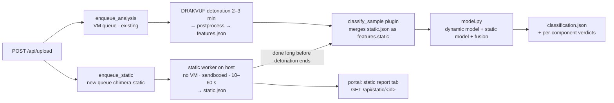

# CHIMERA static analysis + fused verdict: design

Status: proposal, 23 Oct 2026. Companion to `PLAN.md` (dynamic classifier).

## 1. What it adds

When a file is submitted, CHIMERA starts a **static analysis job at the same moment** as the DRAKVUF detonation.
The static job never runs the file. It identifies the type and runs every analyzer that applies,
like MobSF but for any file type. It writes `static.json` and a findings list the portal can show right away.
When detonation finishes, the classifier sees **both** results and returns one verdict, with reasons from each side.

Files CHIMERA can't detonate (APK, Mach-O, a document with no viewer in the guest, …) still get a static-only verdict.

## 2. How it plugs into CHIMERA (sprint/final)

Changes on the platform side (Shreyas):

| Where | Change |
|---|---|
| `drakrun/web/api.py` upload | call `enqueue_static(job_id, sample_path)` next to `enqueue_analysis` |
| new `drakrun/static/worker.py` | RQ worker on queue `chimera-static`; runs `chimera_static.analyze(path, out_dir, timeout)` |
| `classify_sample` plugin | wait up to N s for `static.json`, add it as `features["static"]` (schema `chimera-features/2`; v1 models simply ignore the key) |
| verdict schema | allow an optional `components` field (`{dynamic: {...}, static: {...}}`). Today `runner.py` drops extra keys |
| portal / API | static report tab, `GET /api/static/<id>`, static-only verdict for files that aren't detonated |

**Security, the important one:** static parsers (pefile, oletools, YARA, capa) read hostile files. On CHIMERA
the host is Xen dom0, so a parser bug would hit the hypervisor host. The static worker must run unprivileged,
without network, with CPU/memory/time limits, and ideally in its own container or VM. This needs a line in
`docs/chimera/threat-model.md`.

## 3. The analyzer (`chimera_static`, built by me, standalone library)

`analyze(path, out_dir, timeout_s=60) -> static.json` (schema `chimera-static/1`). Same layout for every type:
`file`, `type`, `universal`, one block per matching plugin, `children` (archive contents), `findings`, `score`, `ml`.

### Layer 0: identify
libmagic + magic bytes + extension, so polyglots, extension mismatches and double extensions (`invoice.pdf.exe`)
become findings. Output: format, platform (windows/linux/macos/android/any), architecture.

### Layer 1: every file, whatever the type
Hashes (MD5/SHA-1/SHA-256, ssdeep, TLSH), size, entropy and entropy profile. ASCII + UTF-16 strings, with IOCs
extracted (URLs, domains, IPs, e-mails, registry and file paths, wallets, base64 blobs). YARA with a curated
public ruleset plus CHIMERA rules. A scan for embedded or appended content (PE/ZIP/OLE inside other files, overlays).

### Layer 2: plugins by type
| Type | Tools | Gives |
|---|---|---|
| PE / DLL / SYS / .NET | pefile, signify, capa (already in CHIMERA), dnfile, **thrember** | headers, sections (entropy, W+X), imports/exports, imphash, rich header, resources, TLS, overlay, signature validity, packer, capa capabilities with ATT&CK, **EMBER v3 vector for ML** |
| ELF | thrember, capa (ELF supported) | arch, interpreter, static/stripped, symbols, UPX, capabilities, **EMBER v3 vector** |
| PDF | thrember, pdfid-style keyword scan | /JS, /OpenAction, /Launch, /EmbeddedFile, URLs, **EMBER v3 vector** |
| Office OLE / OOXML / RTF | oletools (olevba + mraptor, oleid, rtfobj, msodde) | macros, auto-exec, suspicious keywords, DDE, remote templates, embedded objects |
| Scripts (PS1, VBS, JS/JSE, BAT/CMD, HTA, Python, sh) | own heuristics + YARA | download/exec/encode tokens, AMSI bypass, obfuscation metrics |
| LNK | LnkParse3 | target and arguments (cmd/powershell), icon spoofing |
| Archives / containers (ZIP, 7z, RAR, ISO/IMG, CAB, MSI, OneNote) | stdlib/py7zr/pycdlib/olefile | listing, encrypted flag, children analysed recursively (depth 3, ≤200 files, ≤500 MB) |
| APK / DEX (optional) | androguard, thrember | permissions, components, API use, **EMBER v3 vector**; static-only, since CHIMERA has no Android guest |
| Unknown / shellcode | Layer 1 + capa shellcode mode | entropy, strings, capabilities |

`findings`: `{id, title, severity, evidence, attack: [T…], source}` from rules, YARA and capa. `score`: a
MobSF-style 0–100 rule score, used for types that have no ML model.

## 4. Classifier: dynamic + static, late fusion

| Component | Trained on | Covers |
|---|---|---|
| Dynamic model (current) | WinMET → CHIMERA view, + CHIMERA benign | detonated Windows runs |
| **Static ML models** | **EMBER2024** (LightGBM on thrember features), one per format group: Windows PE (Win32+Win64+.NET), ELF, PDF, (APK) | those formats |
| Static rule score | rules + YARA + capa + oletools findings | every other type (Office, scripts, LNK, archives) |

Fusion: calibrated log-odds, each part weighted and gated by quality:
`logit(p) = b + w_d · q_d · logit(p_dynamic) + w_s · logit(p_static)`, where `q_d = 0` when dynamic says
"unknown" (too little behaviour, Linux, crash). Only one available → use that one alone.

Why late fusion rather than one model over all features:
- **No dataset has both raw-file static features and dynamic traces for the same files.** WinMET has no binaries;
  EMBER2024 has no detonations. Separate models can each use the best dataset.
- **The static side has no sandbox gap.** The same `thrember` code computes features for EMBER2024 and for
  CHIMERA uploads, so it can anchor the verdict when the dynamic model suffers from CAPE→DRAKVUF shift or the
  sample hides its behaviour (evasion, sleeping).
- Missing parts are natural (no detonation, nothing observed), and each part stays explainable.

The fusion has only ~3 parameters, so a few hundred **paired** CHIMERA runs are enough to fit it. Benign runs
(Shreyas has the files, so static can run on them) and the Stage 2 / bridge malware give those pairs. Until
then the weights are fixed (equal), and the report says so.

## 5. Datasets: what's needed

| Dataset | Needed? | Why |
|---|---|---|
| **EMBER2024** (Apache-2.0, Hugging Face via `thrember`) | **Yes** | ~3.2M benign + malicious files, Sept 2023–Dec 2024, Win32/Win64/.NET/APK/ELF/PDF, EMBER v3 features from the same extractor we'll run, families and behaviour tags, capa results, plus an evasive "challenge" set. Sizes: Win32 train 23.7 GB / test 4.9 GB, Win64 12.9 / 2.5 GB, .NET 1.8 / 0.4 GB, APK 1.0 / 0.2 GB, PDF 0.2 GB, ELF 0.1 GB, challenge 0.1 GB (~48 GB total) |
| The benign program files Shreyas already ran | **Yes** (no download) | run static on them: CHIMERA-side false-positive check, and paired data for the fusion |
| The 27 M5 test samples (Shreyas, never leaves the host) | **Yes** (no download) | static on the same frozen test set, for the paper's static / dynamic / fused comparison |
| MSOffice VBA Macros Classified (IEEE DataPort) | Optional, later | an ML model for macros instead of rules only |
| SOREL-20M, EMBER2017/2018 | No | older PE-only versions of the same idea |
| Script datasets (PS1/JS/VBS) | No for now | no good labelled public set; rules + YARA instead |

Suggested first download (~10 GB): Win32 test, Win64 test, .NET train+test, ELF, PDF, challenge. Train on the
EMBER test weeks too: we don't need EMBER's benchmark split, we need recent data. Full PE train later if time
allows. Disk is fine (860 GB free); RAM (16 GB) is the limit, so read features memory-mapped and subsample.

## 6. Packages: in the container image, not the drakrun venv (done 23 Oct)

The analyzer's libraries are installed only in the static container image (`static_analyzer/requirements.txt`
in the fork): pefile, signify 0.8.1 (+ oscrypto pinned to an upstream commit, because the 2022 release cannot
detect OpenSSL ≥ 3.0.10), pyelftools, python-magic, yara-python, py-tlsh, ppdeep, numpy, scikit-learn.
thrember's feature extractor is vendored unmodified (Apache-2.0, commit 0ef753e), so polars, matplotlib and
huggingface_hub are not needed. The vectors match the official package exactly. The host needs only Podman.
Still to add with the next plugins: oletools, LnkParse3, pycdlib. Avoid PyMuPDF (AGPL).

## 7. Order of work (deadlines: v0 Sun 25, final Wed 28)

| When | Me | Shreyas |
|---|---|---|
| Fri–Sat | dynamic v0 (benign runs); `chimera_static` Layers 0–1 + PE/ELF/PDF + thrember; download EMBER subset | static queue + worker skeleton, sandboxing, packages |
| Sun | **ship dynamic v0**; train static PE/ELF/PDF models on EMBER2024 | run static on the benign files and the 27 test samples |
| Mon | Office/script/LNK/archive plugins; fusion in `model.py` (fixed weights) | `classify_sample` merges `static.json`; portal tab |
| Tue | fit fusion on paired runs; freeze; evaluate static / dynamic / fused on the test set | Stage 2 runs |
| Wed | **final**: metrics table with all three columns | slides |

If time runs out: ship PE + ELF static ML with Layer 0–1 for everything else. Document the rest as future work.
