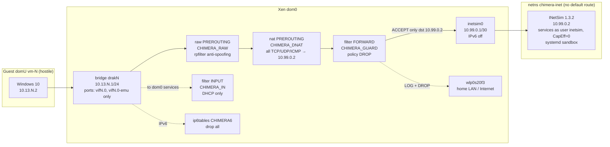

# Containment Results — 2026-10-19

**Status:** containment proposal v2 **applied and verified**. All tests C-1…C13 pass.
**Evidence:** `/var/lib/chimera-evidence/containment-2026-10-19/` on the CHIMERA host (root-only; 776 KB, PCAPs + counters + transcripts). File names below are relative to it.
**Installed from:** `scripts/chimera/containment/` in this repo.

## Topology as deployed

## Results

| ID | What | Result | Evidence |
|---|---|---|---|
| C-1 | Rules applied 3× in throwaway netns; displaced guard; teardown | **PASS**: byte-identical rule sets, displacement detected and repaired, teardown removes only CHIMERA objects | `01-dryrun/`, `RESULTS.md` |
| C0 | `chimera-net-check --require-inetsim` | **PASS** | every step |
| C1 | Guest DNS `example.com` | **PASS**: `10.99.0.2` | `03-guest/guest-tests-C1-C6.txt` |
| C2 | Guest HTTP by name | **PASS**: 200, INetSim page | same |
| C3 | Guest → 203.0.113.10:80 and 8.8.8.8:53 | **PASS**: INetSim answered; Wi-Fi 0 packets | `03-guest/wifi-forbidden.pcap`, `host-side-proof-C1-C6.txt` |
| C4 | Guest → LAN router 192.168.0.1:80 | **PASS**: INetSim page, not the router | same |
| C5 | Guest → dom0 gateway :22/:5000/:6379 | **PASS**: refused; Redis client count unchanged (1); `CHIMERA_IN` dropped 50 | same |
| C6 | Guest IPv6 all-nodes ping | **PASS**: 100 % loss; `CHIMERA6` dropped 40 | same |
| C7 | Listening sockets with VM up | **PASS**: VNC `127.0.0.1:5901`, websocket `127.0.0.1:6401`; nothing on `:53` | transcript |
| C8 | Fail-closed: drakrun `out_interface="default"` (its Wi-Fi ACCEPT + MASQUERADE verified active) | **PASS**: traffic still to INetSim; router ping answered by the netns (seen on `inetsim0`); Wi-Fi 0 packets | `06-c8/` |
| C9 | INetSim netns with a temporary real default route | **PASS**: LAN and dom0 unreachable; counters 0→4 on `CHIMERA_IN` and `CHIMERA_GUARD` (firewall, not routing) | `04-c9/C9.txt` |
| C10 | Spoofing from test bridge `drak9` | **PASS**: forged LAN/other-VM sources dropped by rpfilter (6); GRE/ESP logged + dropped (6); fragments reassembled to INetSim; TTL=1 ICMP stays internal; Wi-Fi 0 guest packets | `08-c10/` |
| C11 | Guest probing ×60 while re-applying 5×, SIGKILL mid-apply, `systemctl restart` | **PASS**: 60/60 served by INetSim; ExecStop refused while domains ran; check OK after every step | `05-c11/` |
| C12 | 3× stop/restore/DHCP/drakshell cycles | **PASS**: 3/3; restore **3.42–3.50 s** | `07-c12/C12.txt` |
| C13 | INetSim privileges | **PASS**: services run as `inetsim`, CapEff 0, NoNewPrivs=1; master CapEff `0x4c1` (CHOWN, SETGID, SETUID, NET_BIND_SERVICE); `/etc` and `/home` read-only | `02-apply/C13-inetsim-privileges.txt` |

## Findings made during testing (changed the implementation)

1. **Xen's `vif-bridge` hotplug script inserts `physdev … -j ACCEPT` rules at FORWARD position 1 on every domain start**, which auto-loads `br_netfilter` with `bridge-nf-call-iptables=1`. Fix: `chimera-net-up` loads `br_netfilter` and sets `bridge-nf-call-{iptables,ip6tables,arptables}=0`. We filter only at the IP layer. The checker tolerates exactly Xen's bridged-only rule pattern above the guard, rejects anything else (negative test: a foreign `-i drak+ -j ACCEPT` is reported), and verifies each `drak*` bridge has only `vif` ports.
2. **PCAP integrity.** With bridge netfilter on, `tcpdump` on `drakN` recorded post-DNAT destinations in the request direction. After fix 1, the capture shows original destinations (60 SYNs to 203.0.113.10 in C11). Important for analysis value.
3. **`drakrun drakshell` CLI bug (upstream).** It connects with a 3 s timeout, then re-injects drakshell into `explorer.exe`, which times out and wedges the guest. The analyzer path connects with `timeout=10` and never re-injects (`drakrun/analyzer/analyzer.py:230`). Workaround used for testing: connect-only helper. To fix in M3.
4. **Snapshot DHCP state.** A restored guest keeps its snapshot IP (`10.13.0.2`) until `ipconfig /release` + `/renew`. Anti-spoofing correctly drops traffic from the stale address. drakrun's post-restore script already does release/renew. The evasion verification path must keep doing it.
5. **drakshell command-line cap** is 2048 bytes of UTF-16 (`drakrun/lib/drakshell.py:297`). Long PowerShell must be chunked or shipped as a file.
6. **Measured:** VM restore from snapshot **3.4–3.5 s** (n=3). The historical "≈1 s" claim isn't reproduced on this host.

## Residual risks (unchanged by this work)
- Hypervisor/device-model escape (T1), parser hardening (T4), evidence integrity (T5): see `threat-model.md`.
- INetSim master runs as root with 4 capabilities inside a sandbox; its services run unprivileged.
- Router NetBIOS probes cause the host to emit ICMP port-unreachable on Wi-Fi every ~60 s. That is host behaviour, unrelated to guests, but future capture filters should exclude it.

## Operational notes
- Status: `sudo chimera-net-check --require-inetsim`
- Services: `chimera-net.service`, `chimera-inetsim.service` (enabled at boot); packaged `inetsim.service` masked; `dnsmasq.service` disabled.
- Rollback: `containment-proposal.md` §6. `chimera-net-down` refuses while `vm-*` domains exist.
- Backups of changed config: `/etc/drakrun/config.toml.bak.20261019-025023`, `/etc/drakrun/cfg.template.bak.20261019-025023`.
