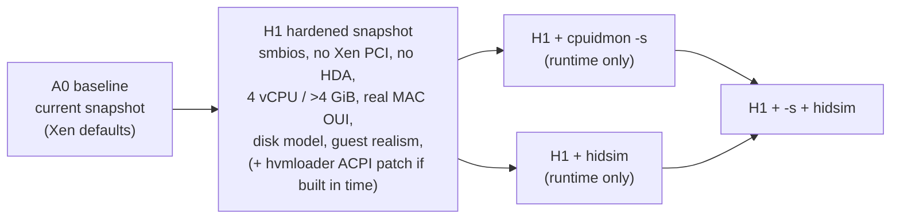

# Xen Guest Hardening — Design and Experiment Plan (M4)

**Date:** 2026-10-19 · **Status:** H1 snapshot live since 07:49 (steps 1–4 below; validated 15/15 on restore, `journal.md` 07:52). Runtime arms (step 5) measured in §6. Not done: hvmloader ACPI patch (step 6) · **Depends on:** containment (done), lifecycle fixes (done), guest-freeze and DRAKVUF UAF fixes (done, `vm-freeze-root-cause.md`)

## 1. Problem (measured, not assumed)

PERDEDOR run `621b62cc` (18 Sep 2026, current Xen guest) detected:

| Check | Evidence | Root cause | Fix class |
|---|---|---|---|
| `win.env.smbios_vendor` | `Manufacturer=Xen Model=HVM domU BIOS=Xen` | hvmloader SMBIOS defaults (`tools/firmware/hvmloader/smbios.c:420,473,477`) | **config** `smbios=[…]` (xl.cfg 4.19.2 §smbios) |
| `win.env.pnp_virtual_devices` | `PCI\VEN_5853…` (Xen platform), `HDAUDIO…VEN_1AF4` | Xen platform PCI device; QEMU HDA codec | **config** `xen_platform_pci=0`; drop `soundhw` |
| `win.env.registry_artifacts` | `HKLM\HARDWARE\ACPI\DSDT\Xen` | ACPI OEM ID `"Xen"` (`tools/libacpi/acpi2_0.h:34`, `dsdt.asl:8`) | **source patch** of hvmloader/libacpi |
| `win.env.low_core_count` | 2 logical CPUs (threshold ≤ 2) | install.json `vcpus=2` | **config** 4 vCPUs |
| `win.env.low_ram` | 4 GiB (threshold ≤ 4) | install.json `memory=4096` | **config** > 4 GiB (dom0 balloon if needed) |
| `win.design.mac_oui` | `00:16:3E` | Xen default OUI | **config** `vif … mac=<real vendor OUI>` |
| `win.behavioural.aged_files` | 1 file older than 7 days (need ≥ 5) | fresh image | **guest realism** in modify-vm0 session |
| `win.behavioural.installed_programs` | 8 (need ≥ 20) | fresh image | **guest realism** |
| `win.behavioural.mouse_movement` | cursor static | no user | **runtime** DRAKVUF `hidsim` (Gruber & Freiling 2022) |
| *(not yet measured)* CPUID hypervisor bit + `XenVMMXenVMM` leaves | `cpuid="host,htt=0"` doesn't hide them | Xen | **runtime** DRAKVUF `cpuidmon -s` (`src/plugins/cpuidmon/cpuidmon.cpp:139-153` zeroes leaf-1 ECX[31] and leaves 0x40000000–0x40000004) |
| disk model `QEMU HARDDISK` | string in qemu-xen | qemu IDE default | **config** `device_model_args_hvm=["-global","ide-hd.model=…"]`: applied in H1, guest reports a WD model (`H1-identity-check-vm1.txt`) |

## 2. Experimental arms

- Each arm runs **PERDEDOR, al-khaser and Pafish as samples through the normal analysis path, with the standard DRAKVUF plugin set active** (Codex finding: the existing evasion path never runs DRAKVUF, so its scores say nothing about stealth under instrumentation).
- n ≥ 5 runs per arm; report per-check detection frequency, not a single score.
- Telemetry check per arm: the hardened guest must still produce the same plugin coverage as A0 (BGInfo control sample).
- Timing checks are reported separately: `cpuidmon -s` traps every CPUID and may *worsen* RDTSC-around-CPUID detections. The experiment decides whether `-s` is kept.

## 3. Implementation sequence (each step reversible)

1. **Back up** `vm-0.img` (25.7 GiB), `snapshot.sav`, `/etc/drakrun/{install.json,cfg.template}`, `profiles/` → `/var/lib/chimera-backups/<date>/` with SHA-256s.
2. **cfg.template profile `H1`**: `smbios=[...]` with one *internally consistent* desktop identity (BIOS vendor/version/date, board, system, chassis, serials); `xen_platform_pci=0`; remove `audio`/`soundhw`; `mac=` with a real Intel OUI; `shadow_memory=128` (upstream #1222 VM-crash fix); `viridian` stays off (needed for `-s` coverage of the Xen leaves).
3. **install.json**: `vcpus=4`; `memory` > 4096 after checking free memory (balloon dom0 with `xl mem-set 0` if required; **never reboot**: the host boots Windows by default).
4. **New snapshot**: `drakrun modify-vm0 begin --cold-boot` → guest realism script via drakshell (≥ 20 installed programs from offline installers or portable apps registered normally, ≥ 5 user documents with realistic timestamps, browser profile) → wait > 10 min uptime → `drakrun modify-vm0 commit` → regenerate VMI profile.
5. **Runtime toggles** via `/etc/drakrun/config.toml`: `plugins += ["cpuidmon", "hidsim"]`, `extra_drakvuf_args = { "-s" = true, "--hid-random-clicks" = true }` per arm.
6. **Optional hvmloader patch** (ACPI OEM ID): build hvmloader only from `/opt/xen-4.19.2`, install alongside the original (keep a backup), new snapshot. Skip if time runs short; then the DSDT `Xen` OEM ID is a documented residual.

## 4. Known residuals (will be stated in the report)
- Xen CPUID leaves without `-s`; timing side channels (RDTSC/VM-exit cost); EPT/altp2m-specific detections; qemu-xen device set (e1000, stdvga) fingerprints beyond strings.
- **Teaching to the test:** PERDEDOR's thresholds are ours. Independent suites (al-khaser, Pafish, VMAware) are required to support any "harder to detect" claim.

## 5. Sources
- Xen 4.19.2 `xl.cfg` manual on this host: `smbios`, `xen_platform_pci`, `viridian`, `cpuid`, `device_model_args_hvm`.
- DRAKVUF source `/opt/drakvuf` (`da982ab`): `src/main.cpp:245,758`, `src/plugins/cpuidmon/cpuidmon.cpp:139-153`; `drakvuf -h` hidsim options.
- Gruber & Freiling, "Fighting Evasive Malware: How to Pass the Reverse Turing Test by Utilizing a VMI-Based Human Interaction Simulator", GI SICHERHEIT 2022 — https://dl.gi.de/items/f6dd1ed9-db6f-4555-bab4-5bf103c3e5c3/full
- DRAKVUF issue #1883 (Win11 lab with `hypervisor=0`, `viridian=0`, spoofed SMBIOS) — https://github.com/tklengyel/drakvuf/issues/1883
- drakvuf-sandbox issue #1222 (`shadow_memory` 32→128 fixes VM crashes) — https://github.com/CERT-Polska/drakvuf-sandbox/issues/1222
- Lindorfer, Kolbitsch, Milani Comparetti, "Detecting Environment-Sensitive Malware" (DISARM), RAID 2011 — https://seclab.cs.ucsb.edu/publications/lindorfer2011detecting_environment-sensitive
- Miramirkhani et al., "Spotless Sandboxes: Evading Malware Analysis Systems using Wear-and-Tear Artifacts", IEEE S&P 2017 (in `Chimera-docs/Research_Papers`)
