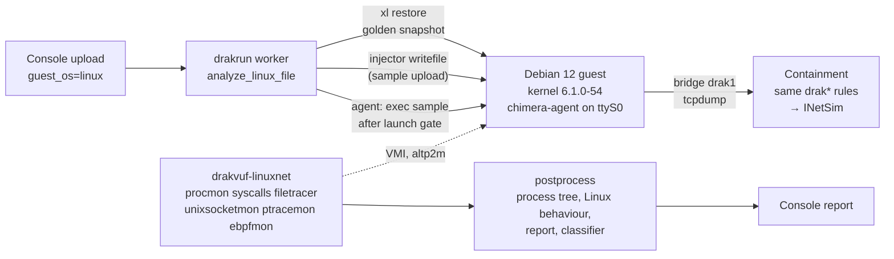

# Linux sandbox

CHIMERA analyses Linux ELF samples in a Debian 12 guest on the same Xen + DRAKVUF stack as Windows, with the
same containment, the same report format and the same console. Choose **Linux** on the upload page, or run
`drakrun analyze --guest-os linux`.

## How it relates to upstream

- **DRAKVUF Sandbox (drakrun) supports Windows guests only.** Its README lists Windows 10 and Windows 7 x64, and
  it has no Linux install path, agent or profile step.
- **DRAKVUF itself supports Linux 2.6–6.x guests.** It ships `dwarf2json` for the kernel profile, and marks per
  plugin which OS it supports (`src/plugins/plugins.h`).
- **The Linux sandbox is DRAKVUF's Linux introspection, wired into the drakrun pipeline.** The pieces with no
  upstream equivalent are marked *ours* below.



| Part | How | Source |
|---|---|---|
| Guest image | Official Debian 12 nocloud qcow2, grown to 20 GB, turned into a **desktop PC**: XFCE on LightDM with autologin to an ordinary user (`arjun`, in the sudo group), Firefox ESR, LibreOffice, India locale and time zone, a home directory with dated documents, shell history and recent files, no screen lock or blanking. Also everyday server tools, regenerated SSH host keys, and the noisy timers masked (apt, man-db, fstrim, timesyncd). `PROFILE=server` builds the plain server image | `drakrun/data/linux/build-image.sh`, `desktop.sh` |
| Kernel profile | Debian `linux-image-6.1.0-54-amd64-dbg` → `dwarf2json` → ISF JSON, passed with `-r`. The guest kernel is the same build as dom0 | DRAKVUF's documented method |
| Profile tweak | The 12 anonymous-union members of `iov_iter` are flattened so DRAKVUF resolves them. Flattening the whole profile broke procmon, so it is limited to this struct | *ours*: `drakrun/lib/linux_profile.py` |
| VM | HVM, `altp2m=2`, 4 vCPU, 4096 MB, stdvga, e1000 NIC, serial on a unix socket, VNC on localhost. Reuses drakrun's `VirtualMachine`, storage backend (qcow2 `vm-0.img` + overlays), snapshot restore and per-VM lock | `drakrun/data/linux/cfg-linux.template`, `drakrun/lib/linux_install.py` |
| Guest control | `chimera-agent`: a small Python service on ttyS0 that answers ping, clock, net, prepare, stat, chmod, exec and sh. drakshell is Windows-only | *ours*: `drakrun/data/linux/chimera-agent.py`, `drakrun/lib/linux_agent.py` |
| Sample upload | `injector -m writefile` in the agent process; sha256 checked in the guest | upstream injector |
| Launch gate | DRAKVUF starts first. The agent runs `/bin/true chimera-ready-<random>`, and the sample starts only after procmon logs that marker, so its first events are not lost | *ours*: `linux_analyzer.py` |
| Telemetry | procmon, syscalls (88 syscalls, `drakrun/data/linux-syscalls.txt`), filetracer, unixsocketmon, ptracemon, ebpfmon | DRAKVUF Linux plugins |
| Network addresses | The syscalls plugin decodes `sockaddr` for connect, sendto, sendmsg and bind (`ip:port`, IPv6, `unix:path`, netlink). It runs in a separate binary, `/usr/local/bin/drakvuf-linuxnet`; Windows keeps the validated `drakvuf` | *ours*: `scripts/chimera/patches/drakvuf-linuxnet-sockaddr.patch` |
| Report | Same sections as Windows: process tree, modified/deleted files, connections, DNS, HTTP requests. Adds `linux.{links, permission_changes, unix_sockets, fileless_execs, network_syscalls, syscall_counts}` | `get_linux_behaviour_info.py` |
| Live view, screenshots | Same as Windows: the console's live interaction tab (noVNC on websocket 6400+N) and the screenshotter (VNC 5900+N). The sample gets the desktop's display (`DISPLAY=:0`), so GUI programs appear | drakrun |
| Guest clock | Uses the Xen clocksource, so it is already correct after restore; the agent records the offset | `set_guest_clock` |

## Results (20 Oct)

| Test | Result |
|---|---|
| Reliability: 30 runs of the benign probe (`bench/probe.c`), dynamic and static builds alternating | **30/30** pass all 16 checks (process tree, exit codes, file create/rename/chmod/symlink/delete, TCP and DNS attributed to the process, telemetry complete, launch gate). Run time 74.7–77.3 s for a 60 s analysis |
| Containment from the Linux guest (`containment_test.py`, evidence in `/var/lib/chimera-evidence/linux-containment-2026-10-20/`) | **All pass.** C0 checker before and after. C1 DNS → 10.99.0.2. C2/C3 HTTP by name and by IP, UDP DNS to 8.8.8.8, all answered by INetSim. C4 LAN router → INetSim page. C5 dom0 :22/:5000/:6379 refused, CHIMERA_IN +20. C6 IPv6 dropped, CHIMERA6 +20. L1 host SSH on the LAN address refused. **0 guest packets on the uplink** |
| Desktop image (4 vCPU, 4096 MB) | probe 16/16 checks through the console; screenshots show the XFCE desktop; containment test all pass again (`linux-containment-desktop-2026-10-20/`) |
| Snapshot restore | 6.96 s for the 4 GB desktop (1.55 s for the 2 GB server image; Windows 3.4–3.5 s) |
| Evasion scan (`chimera-vmcheck`, see `linux-evasion.md`) | Runs in 20 s. Score 70.44: 17 of 34 checks see the VM (Xen in CPUID, DMI, `/sys/hypervisor`, dmesg and clocksource, QEMU disk and PCI IDs, `chimera-agent`, 20 GB disk). Activity checks pass: uptime, 141 processes, logged-in desktop user, shell history, recent files |
| Through the console | Upload with Linux selected → worker → report, process tree and classifier verdict in the portal |
| Windows regression after the Linux changes | BGInfo: telemetry complete, no postprocess failures, clock set, full report |

## Coverage compared with Windows

The extended probe (`bench/probe_ext.c`) performs behaviours Linux malware commonly shows. Results are from a
real run:

| Behaviour | Windows | Linux | Seen by |
|---|---|---|---|
| Process tree, command lines, exit codes | ✓ | ✓ | procmon |
| Library/API calls | ✓ apimon (user-mode, 262 APIs) | ◐ system calls only (88), no libc-level hooks | syscalls |
| File writes, deletes, renames | ✓ | ✓ | filetracer |
| Persistence | ✓ registry (regmon) | ✓ cron.d and systemd unit writes | filetracer |
| Network connections per process | ✓ socketmon | ✓ decoded connect/sendto + pcap | syscalls (patched) |
| DNS queries per process | ✓ | ✓ | pcap + sendto |
| HTTP requests | ✓ WinHTTP/WinINet hooks | ✓ plaintext HTTP from the pcap | pcap |
| TLS contents | ✓ tlsmon keys; INetSim requests | ◐ INetSim requests for accepting clients; ClientHello SNI/JA3 otherwise | INetSim service log + pcap |
| ptrace (anti-debug, injection) | n/a | ✓ | ptracemon |
| Fileless execution (memfd) | n/a | ✓ shown as `[fileless] argv0` | procmon |
| eBPF program load | n/a | ◐ `bpf` syscall seen; ebpfmon logs nothing | syscalls |
| Unix socket use | n/a | ◐ path from connect/bind; unixsocketmon logs nothing | syscalls (patched) |
| VM-detection reads (`/sys/class/dmi`, `/proc/cpuinfo`) | ✓ apimon | ✓ open events | filetracer |
| Memory dumps, capa, ATT&CK TTPs | ✓ | ◐ ELF cores packaged; live test pending; no capa on cores | procdump2 |
| Screenshots, live view, user activity | ✓ | ✓ XFCE desktop with an autologin user | screenshotter, noVNC |
| Anti-detection hardening | ✓ H1–H3 | ✗ guest still shows Xen in DMI, CPUID and dmesg (evasion score 70.44) | – |

## Memory dumps

Linux enables `procdump2` by default. It writes x64 ELF cores, not Windows region dumps.
The references below are relative to the DRAKVUF source root (`chimera-console/drakvuf`).
`src/plugins/procdump2/procdump2.cpp:110` selects the Linux implementation.
The plugin README describes Windows hooks (`src/plugins/procdump2/README.md:8`); Linux uses `do_exit`.

The command adds `--procdump-dir <analysis>/dumps`, `--procdump-use-maple-tree` for kernel 6.1,
`--procdump-new-processes-on-finish`, and `--procdump-timeout 10`.
Exit dumps need no extra flag (`src/plugins/procdump2/linux.cpp:795`, `:845`).
The finish flag enumerates **all** running processes, including processes present before analysis
(`src/plugins/procdump2/linux.cpp:853`). Its timeout is checked between dumps, after shutdown starts;
it cannot interrupt a copy (`src/plugins/procdump2/linux.cpp:777`).
There is no on-demand Linux PID option. The injected-PID finish setting is not used on Linux.
Options are declared in `src/main.cpp:324`, parsed at `:918`, stored in `src/plugins/plugins.h:178`,
and passed through `src/plugins/plugins.cpp:459`.
`--procdump-disable-dump-on-finish` only clears the injected-PID setting (`src/main.cpp:1189`).
Compression flags exist; we leave compression off and compress the archive once.

Files are `dumps/procdump.<SN>` and `dumps/procdump.<SN>.metadata`
(`src/plugins/procdump2/linux_private.h:176`, `src/plugins/procdump2/linux.cpp:138`).
The cores use `ET_CORE` (`src/plugins/procdump2/linux_coredump.h:704`).
Success events contain `TargetPID`, `TargetName`, `DumpReason` (`TerminateProcess` or `FinishAnalysis`),
numeric `DumpSize`, `SN`, and `Status: "Success"` (`src/plugins/procdump2/linux.cpp:378`).
Common fields include `PID`, `PPID`, `ProcessName` and `TimeStamp`. `EventUID` is zero here.
The JSON plugin name is **`procdump`**, so splitting produces `procdump.log`, not `procdump2.log`.
Failures and exclusions go to `procdump_fail.log` and `procdump_skip.log` (`linux.cpp:332`, `:344`).
Sidecars contain size, process identity, compression, status, filename and sequence number; no dump reason.

There is only a process-name exclusion list, no sample-tree include filter (`linux.cpp:735`).
Postprocessing keeps the sample and its descendants from `inject.log` and `process_tree.json`.
It matches dumps by PID and timestamp because their event IDs cannot identify a process instance.
If the sample tree is unavailable, it warns and keeps all dumps within the limits. Unmatched seqids are null.
It reuses `[memdump]`: 512 bytes minimum, 32 MiB per file, 500 MiB total by default.
These are strict limits on the uncompressed files packed, **not capture-time disk limits**.
Large cores need larger configured limits. Background processes can consume disk and finish-sweep time.
The plugin also remembers completed PIDs, so PID reuse can suppress later exit dumps (`linux.cpp:789`).

After postprocessing, expect `dumps.zip` with members `dumps/procdump.<SN>`.
`metadata.json` contains `dumps_metadata` with filename, process name, PID, process seqid, size, SHA-256 and reason.
`report.json` contains `memdumps` grouped by process seqid. Raw cores and sidecars are removed.
If no core survives, the ZIP contains only `dumps/` and metadata is empty.
Capa remains Windows-only: [ELF core support is still an open upstream request](https://github.com/mandiant/capa/issues/784).

A live Xen test is still needed. Use a small process that exits and a child that sleeps past the analysis timeout.
Check `procdump.log` for `Status: "Success"` with each dump reason and the expected `TargetPID`.
Check the worker log for `Linux dumps: packed N files (B bytes), filtered F`, with N greater than zero.
Check `metadata.json` for `postprocess.process_linux_dumps: "ok"` and nonempty `dumps_metadata`.
Verify the ZIP hashes, process attribution, ELF headers with `readelf -h`, maple-tree profile offsets,
shutdown time and peak disk use. Check `procdump_fail.log` and `drakvuf_stderr.log` for failures.

## TLS contents

INetSim logs decrypted requests from clients that accept its certificate. Both Windows and Linux reports
show these requests and TLS errors. `tls_sessions.json` keeps the sessions and ClientHello metadata from
`dump.pcap`, including SNI, ALPN, offered TLS version and JA3. Pinned or validating clients expose only
ClientHello metadata such as SNI and JA3. They do not expose request contents through INetSim.

Sessions match the pcap by source port and time. Linux reuses connection process attribution. Windows uses
socketmon connections when available. Ambiguous matches and rewritten source ports stay unmatched.
TCP gaps, out-of-order packets and IP fragments can prevent ClientHello extraction.

The worker must be able to read the host-local INetSim service log. Set `drakrun.inetsim_service_log` in the
TOML config, or `drakrun__drakrun__inetsim_service_log` in its environment, to change the default
`/var/log/chimera-inetsim/service.log`. Missing or unreadable logs produce a warning. ClientHello metadata
still appears. Log rotation can remove old sessions before reprocessing.

## Known gaps

1. **unixsocketmon and ebpfmon log nothing**, even when a named unix socket is used and a BPF program loads. The
   syscalls plugin covers both, so the report still shows them. Fixing it needs a DRAKVUF debug build.
2. **filetracer paths on non-root mounts are mount-relative**, for example `/system.slice/...` for cgroupfs and
   `/systemd/...` for `/run`. Root-filesystem paths are correct.
3. **Background noise.** systemd-journald, systemd-hostnamed and LLMNR from systemd-resolved appear in every
   run, attributed to their own processes.
4. **Memory dumps need a live test. No TLS keys** on Linux.
5. **The guest is not hardened against VM detection**: DMI vendor and CPUID hypervisor bit.

## Installing and changing the golden image

The same commands as for Windows, with `--guest-os linux`:

```bash
# kernel profile from Debian's debug package of the guest kernel (once per kernel)
sudo drakrun make-profile --guest-os linux --debug-package linux-image-6.1.0-54-amd64-dbg_6.1.190-1_amd64.deb
# build vm-0.img from the official cloud image and boot vm-0 (VNC :5900 shows the desktop)
sudo drakrun install --guest-os linux debian-12-nocloud-amd64.qcow2      # --linux-profile server, --vcpus, --memory
# settle, clean up, save the snapshot, check that vm-1 restores from it
sudo drakrun postinstall --guest-os linux
# change the golden image later (install software, change settings), like modify-vm0 on Windows
sudo drakrun modify-vm0 begin --guest-os linux
sudo drakrun modify-vm0 commit --guest-os linux        # or: rollback --guest-os linux
```

| | Windows | Linux |
|---|---|---|
| Install info | `/etc/drakrun/install.json` | `/var/lib/drakrun/linux/golden/install.json` |
| Golden disk + snapshot | `/var/lib/drakrun/volumes/{vm-0.img,snapshot.sav}` | `/var/lib/drakrun/linux/golden/{vm-0.img,snapshot.sav}` |
| xl template | `/etc/drakrun/cfg.template` | `/etc/drakrun/cfg-linux.template` |
| How vm-0 is made | by hand from an ISO | `data/linux/build-image.sh` from the cloud image |
| Kernel profile | `drakrun make-profile` (PDBs) | `drakrun make-profile --guest-os linux` (dwarf2json) |

The kernel profile must match the guest kernel exactly. The image build refuses to continue if apt changed the
kernel, and `postinstall` checks `uname -r` before saving. The previous `vm-0.img` and `snapshot.sav` are kept as
`*.prev`.

## Tests

```bash
sudo /opt/chimera/venv/bin/python scripts/chimera/linux/bench/run_linux.py SAMPLE --out-root DIR
sudo /opt/chimera/venv/bin/python scripts/chimera/linux/bench/check_probe.py DIR/<id>
sudo /opt/chimera/venv/bin/python scripts/chimera/linux/containment_test.py EVIDENCE_DIR
```

These need the VM slot free, so stop `drakrun-worker@1` first.
