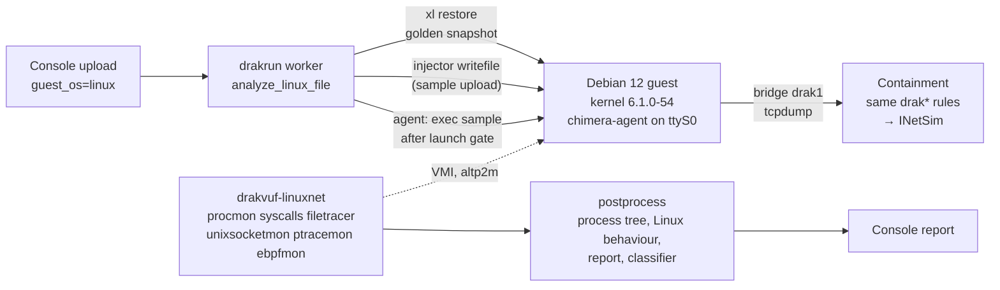

# Linux sandbox

CHIMERA analyses Linux ELF samples in a Debian 12 guest on the same Xen + DRAKVUF stack as Windows, with the
same containment, the same report format and the same console. Choose **Linux** on the upload page, or run
`drakrun analyze --guest-os linux`.

## How it relates to upstream

- **DRAKVUF Sandbox (drakrun) supports Windows guests only.** Its README lists Windows 10 and Windows 7 x64, and
  it has no Linux install path, agent or profile step.
- **DRAKVUF itself supports Linux 2.6–6.x guests.** It ships `dwarf2json` for the kernel profile, and marks per
  plugin which OS it supports (`src/plugins/plugins.h`).
- **The Linux sandbox is DRAKVUF's Linux introspection, wired into the drakrun pipeline.** The pieces with no
  upstream equivalent are marked *ours* below.



| Part | How | Source |
|---|---|---|
| Guest image | Official Debian 12 nocloud qcow2, grown to 12 GB. Adds everyday server packages, regenerates SSH host keys, masks the timers that make noise (apt, man-db, fstrim, timesyncd), hostname `srv-app01` | `scripts/chimera/linux/build-linux-image.sh` |
| Kernel profile | Debian `linux-image-6.1.0-54-amd64-dbg` → `dwarf2json` → ISF JSON, passed with `-r`. The guest kernel is the same build as dom0 | DRAKVUF's documented method |
| Profile tweak | The 12 anonymous-union members of `iov_iter` are flattened so filetracer resolves them. Flattening the whole profile broke procmon, so it is limited to this struct | *ours*: `flatten_profile.py` |
| VM | HVM, `altp2m=2`, 2 vCPU, 2048 MB, e1000 NIC, serial on a unix socket, VNC on localhost. Reuses drakrun's `VirtualMachine`, snapshot restore and per-VM lock | `cfg-linux.template`, `make_golden.py` |
| Guest control | `chimera-agent`: a small Python service on ttyS0 that answers ping, clock, net, prepare, stat, chmod, exec and sh. drakshell is Windows-only | *ours*: `guest/chimera-agent.py`, `drakrun/lib/linux_agent.py` |
| Sample upload | `injector -m writefile` in the agent process; sha256 checked in the guest | upstream injector |
| Launch gate | DRAKVUF starts first. The agent runs `/bin/true chimera-ready-<random>`, and the sample starts only after procmon logs that marker, so its first events are not lost | *ours*: `linux_analyzer.py` |
| Telemetry | procmon, syscalls (88 syscalls, `drakrun/data/linux-syscalls.txt`), filetracer, unixsocketmon, ptracemon, ebpfmon | DRAKVUF Linux plugins |
| Network addresses | The syscalls plugin decodes `sockaddr` for connect, sendto, sendmsg and bind (`ip:port`, IPv6, `unix:path`, netlink). It runs in a separate binary, `/usr/local/bin/drakvuf-linuxnet`; Windows keeps the validated `drakvuf` | *ours*: `scripts/chimera/patches/drakvuf-linuxnet-sockaddr.patch` |
| Report | Same sections as Windows: process tree, modified/deleted files, connections, DNS, HTTP requests. Adds `linux.{links, permission_changes, unix_sockets, fileless_execs, network_syscalls, syscall_counts}` | `get_linux_behaviour_info.py` |
| Guest clock | Uses the Xen clocksource, so it is already correct after restore; the agent records the offset | `set_guest_clock` |

## Results (20 Oct)

| Test | Result |
|---|---|
| Reliability: 30 runs of the benign probe (`bench/probe.c`), dynamic and static builds alternating | **30/30** pass all 16 checks (process tree, exit codes, file create/rename/chmod/symlink/delete, TCP and DNS attributed to the process, telemetry complete, launch gate). Run time 74.7–77.3 s for a 60 s analysis |
| Containment from the Linux guest (`containment_test.py`, evidence in `/var/lib/chimera-evidence/linux-containment-2026-10-20/`) | **All pass.** C0 checker before and after. C1 DNS → 10.99.0.2. C2/C3 HTTP by name and by IP, UDP DNS to 8.8.8.8, all answered by INetSim. C4 LAN router → INetSim page. C5 dom0 :22/:5000/:6379 refused, CHIMERA_IN +20. C6 IPv6 dropped, CHIMERA6 +20. L1 host SSH on the LAN address refused. **0 guest packets on the uplink** |
| Snapshot restore | 1.55 s (Windows: 3.4–3.5 s) |
| Through the console | Upload with Linux selected → worker → report, process tree and classifier verdict in the portal |
| Windows regression after the Linux changes | BGInfo: telemetry complete, no postprocess failures, clock set, full report |

## Coverage compared with Windows

The extended probe (`bench/probe_ext.c`) performs behaviours Linux malware commonly shows. Results are from a
real run:

| Behaviour | Windows | Linux | Seen by |
|---|---|---|---|
| Process tree, command lines, exit codes | ✓ | ✓ | procmon |
| Library/API calls | ✓ apimon (user-mode, 262 APIs) | ◐ system calls only (88), no libc-level hooks | syscalls |
| File writes, deletes, renames | ✓ | ✓ | filetracer |
| Persistence | ✓ registry (regmon) | ✓ cron.d and systemd unit writes | filetracer |
| Network connections per process | ✓ socketmon | ✓ decoded connect/sendto + pcap | syscalls (patched) |
| DNS queries per process | ✓ | ✓ | pcap + sendto |
| HTTP requests | ✓ WinHTTP/WinINet hooks | ✓ plaintext HTTP from the pcap | pcap |
| TLS contents | ✓ tlsmon keys | ✗ | – |
| ptrace (anti-debug, injection) | n/a | ✓ | ptracemon |
| Fileless execution (memfd) | n/a | ✓ shown as `[fileless] argv0` | procmon |
| eBPF program load | n/a | ◐ `bpf` syscall seen; ebpfmon logs nothing | syscalls |
| Unix socket use | n/a | ◐ path from connect/bind; unixsocketmon logs nothing | syscalls (patched) |
| VM-detection reads (`/sys/class/dmi`, `/proc/cpuinfo`) | ✓ apimon | ✓ open events | filetracer |
| Memory dumps, capa, ATT&CK TTPs | ✓ | ✗ (procdump2 exists but is untested) | – |
| Screenshots, user activity | ✓ | n/a (server guest) | – |
| Anti-detection hardening | ✓ H1–H3 | ✗ guest still shows Xen in DMI and CPUID (out of scope for 31 Oct) | – |

## Known gaps

1. **unixsocketmon and ebpfmon log nothing**, even when a named unix socket is used and a BPF program loads. The
   syscalls plugin covers both, so the report still shows them. Fixing it needs a DRAKVUF debug build.
2. **filetracer paths on non-root mounts are mount-relative**, for example `/system.slice/...` for cgroupfs and
   `/systemd/...` for `/run`. Root-filesystem paths are correct.
3. **Background noise.** systemd-journald, systemd-hostnamed and LLMNR from systemd-resolved appear in every
   run, attributed to their own processes.
4. **No memory dumps or TLS keys** on Linux.
5. **The guest is not hardened against VM detection**: DMI vendor and CPUID hypervisor bit.

## Rebuilding

```bash
sudo scripts/chimera/linux/build-linux-image.sh
sudo /opt/chimera/venv/bin/python scripts/chimera/linux/make_golden.py
sudo /opt/chimera/venv/bin/python scripts/chimera/linux/bench/run_linux.py SAMPLE --out-root DIR
sudo /opt/chimera/venv/bin/python scripts/chimera/linux/bench/check_probe.py DIR/<id>
sudo /opt/chimera/venv/bin/python scripts/chimera/linux/containment_test.py EVIDENCE_DIR
```

The kernel profile must match the guest kernel exactly. `build-linux-image.sh` refuses to continue if apt
changed the kernel. The bench and containment scripts need the VM slot free, so stop `drakrun-worker@1` first.
