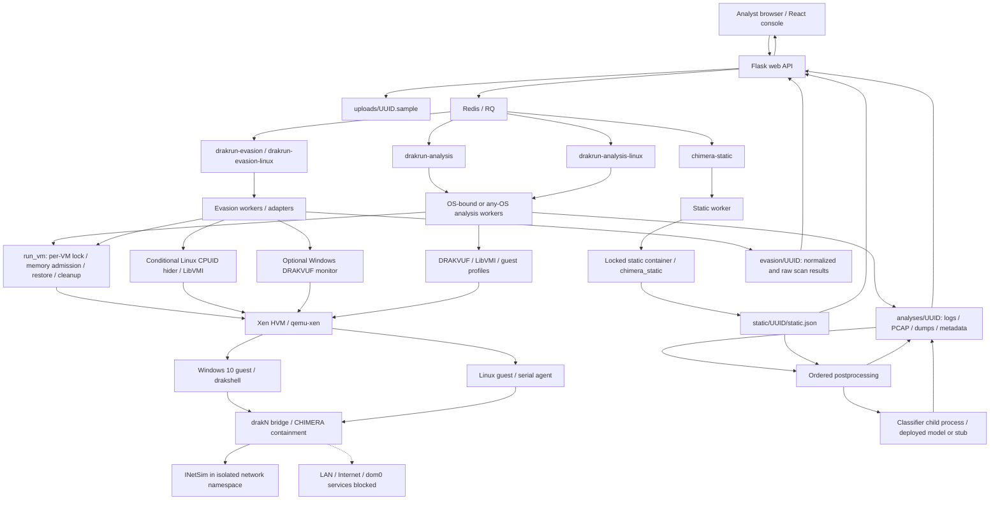
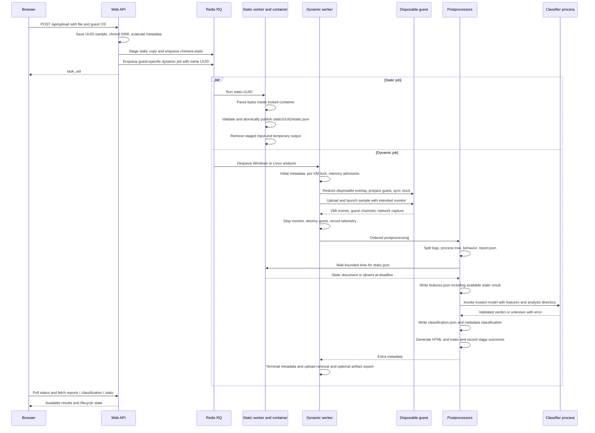
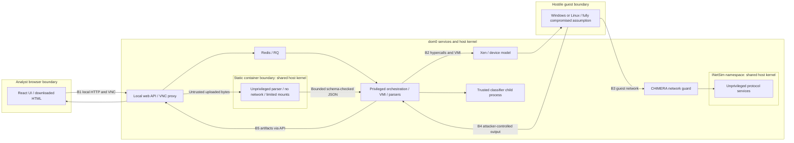
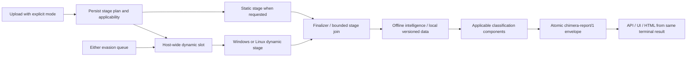

# CHIMERA architecture

Checkout audit: 25 October 2026; Group 3. The first section describes source behavior, with optional features explicitly conditional. It does not certify the live deployment. The final section is a proposed target after the 31 October plan, not implemented behavior.
Repository references are `path:line`. External claims, if introduced, require [V]/[S]/[K] and a URL; the architecture below relies on this checkout.

## Architecture in this checkout

The React console calls the Flask API, which stages uploads and queues work. Static work is a separate job started at upload when enabled; dynamic work is routed by guest OS. Classification is a dynamic postprocessing step that can join the static result with a bounded wait. There is no independent combined-analysis finalizer in this path (`drakrun/web/frontend/package.json:25`; `drakrun/web/api.py:62`; `drakrun/analyzer/worker.py:212`; `drakrun/analyzer/postprocessing/plugins/classify_sample.py:10`).

### Components and data flow

Diagram evidence and qualifications:

- Queue names: `drakrun/analyzer/worker.py:27`; `drakrun/analyzer/static/worker.py:30`; `drakrun/evasion/constants.py:11`. Evasion now has a Linux-specific queue as well as `drakrun-evasion`; the older single-queue account in `docs/chimera/linux-evasion.md:7` is stale (`drakrun/evasion/worker.py:89`).
- Workers select queue sets by OS; the analysis worker dispatches Windows/Linux analyzers, and evasion uses platform-specific adapters (`drakrun/analyzer/worker.py:155`, `:191`; `drakrun/evasion/worker.py:97`, `:248`). An `any` worker is an alternative configuration, not a claim that all worker variants run together.
- Both lanes share `run_vm`: per-VM lock, stale-domain reclamation, restore under memory admission, and destruction in `finally`. The host admission lock spans restore only; different VM IDs may execute concurrently once restored (`drakrun/analyzer/run_tools.py:210`, `:230`; `drakrun/lib/memory_admission.py:37`).
- Windows uses drakshell and injector integration; Linux uses a serial agent and injector writefile, then DRAKVUF monitoring (`drakrun/analyzer/analyzer.py:118`, `:174`; `drakrun/analyzer/linux_analyzer.py:3`, `:116`, `:229`). “Agentless” describes VMI observation; the checkout still uses guest-side orchestration helpers.
- Evasion is separate from malware verdicts. PERDEDOR runs on both OSes, al-khaser on Windows, vmcheck on Linux. Windows can use attached monitoring; Linux full-DRAKVUF evasion is rejected, while its session conditionally attaches a separate CPUID hider and detaches it for injector transfers (`drakrun/evasion/linux_guest_runner.py:74`, `:123`, `:184`). Linux dynamic analysis always adds cpuidmon and `-s` (`drakrun/analyzer/linux_analyzer.py:164`). Linux full-monitor rejection is enforced (`drakrun/evasion/verifiers/__init__.py:33`; `drakrun/web/evasion_api.py:144`; `drakrun/evasion/worker.py:434`).
- Containment topology is documented as guest bridge → anti-spoofing/DNAT/guard → INetSim namespace, with host INPUT and IPv6 drops. This is recorded deployment evidence, not something the API creates on every upload (`docs/chimera/containment-results-2026-10-19.md:8`, `:36`). Worker service templates require containment preflight (`scripts/chimera/systemd/drakrun-worker@.service:10`; `scripts/chimera/systemd/drakrun-evasion-worker@.service:10`).
- Storage root is `/var/lib/drakrun`; diagrams abbreviate paths relative to it. Config/profiles are `/etc/drakrun`, `/var/lib/drakrun/profiles`; Windows snapshots default to `volumes`; Linux golden install data lives under `linux/golden` (`drakrun/lib/paths.py:4`; `docs/chimera/linux-evasion.md:27`).
- Optional S3 handling exists: uploads can move there; completed dynamic artifacts can be uploaded and local analysis directories removed. Static results deliberately remain local (`drakrun/web/api.py:99`; `drakrun/analyzer/worker.py:185`; `drakrun/web/api.py:377`). No external storage is required by this diagram or used by this audit.

### One combined analysis: upload to verdict

“Combined” here means static enabled plus dynamic analysis plus classifier enabled; it is not a current upload-mode enum. Static staging precedes dynamic enqueue. The independent static job may finish before or after detonation (`drakrun/web/api.py:90`; `drakrun/analyzer/postprocessing/plugins/classify_sample.py:16`).

Sequence evidence: upload and enqueue `drakrun/web/api.py:80`, `:109`, `:144`; static lifecycle `drakrun/analyzer/static/worker.py:41`, `:52`; Windows execution and telemetry `drakrun/analyzer/analyzer.py:341`, `:432`; Linux execution and telemetry `drakrun/analyzer/linux_analyzer.py:229`, `:277`; postprocessing order `drakrun/analyzer/postprocessing/plugins/__init__.py:24`, `:103`; classifier join/output `drakrun/analyzer/postprocessing/plugins/classify_sample.py:14`; final state/cleanup `drakrun/analyzer/worker.py:168`; API result routes `drakrun/web/api.py:207`, `:356`.

A static exception during enqueue is logged and does not block dynamic upload. Missing static output after the wait yields absent static input; it does not cause a later automatic reclassification. Model timeout/error becomes `unknown`. Missing model path selects the explicitly named stub (`drakrun/web/api.py:92`; `drakrun/analyzer/static/worker.py:82`; `drakrun/analyzer/classifier/runner.py:89`, `:101`).

`report.json` is written before classification. Its `info` is a snapshot of metadata at that stage, not the authoritative final verdict envelope. The HTML embeds the then-current metadata plus extra metadata before the worker writes terminal status and before postprocessing records its complete outcome map. Consumers needing terminal state should use final `metadata.json` and the separate verdict (`drakrun/analyzer/postprocessing/plugins/generate_report.py:46`; `drakrun/analyzer/postprocessing/plugins/generate_html_report.py:20`; `drakrun/analyzer/postprocessing/postprocess.py:64`; `drakrun/analyzer/worker.py:183`).

### Trust boundaries

- B1–B6 retain the threat model’s meanings; B6 (reviewed source/config entering privileged execution) is described here rather than drawn as a running service. Deployment is recorded as root-owned `/opt/chimera/src` and `/opt/chimera/venv`; local API/VNC has no application authentication and depends on loopback access (`docs/chimera/threat-model.md:23`, `:89`, `:94`).
- B2 is the hypervisor/device-model boundary. Guest output crossing B4 is hostile even if serialized as JSON; privileged parsers and VMI remain attack surfaces. The device model is not documented as deprivileged (`docs/chimera/threat-model.md:56`, `:73`).
- Static isolation is within dom0, sharing its kernel: no network, read-only root, capabilities dropped, no-new-privileges, configured nonroot UID/GID, PID/memory/CPU limits, restricted mounts and timeout. The worker accepts a bounded nonsymlink `chimera-static/1` JSON file (`drakrun/analyzer/static/sandbox.py:40`, `:97`).
- The classifier child is process separation for timeout/failure handling, not the static container boundary. The runner loads trusted model Python and passes the analysis directory. Contrary to the interface document’s “no network” description, this runner contains no network namespace/seccomp restriction; any deployment-level restriction was not verified (`docs/chimera/classifier-interface.md:19`; `drakrun/analyzer/classifier/runner.py:107`, `:139`).
- INetSim’s namespace also shares the host kernel. Recorded controls block namespace-initiated host/LAN access; services are unprivileged while the master retains limited capabilities (`docs/chimera/threat-model.md:68`; `docs/chimera/containment-results-2026-10-19.md:48`, `:52`).
- B5 includes report rendering and downloadable captures/dumps. These remain hostile data; do not open them as root on dom0. Static containment does not sandbox the dynamic postprocessors (`docs/chimera/threat-model.md:73`, `:79`, `:120`).

### On-disk artifacts per analysis

Let `A=/var/lib/drakrun/analyses/<UUID>` and `S=/var/lib/drakrun/static/<UUID>`. Entries are conditional on enabled plugins, OS, success and retention settings; an absent artifact is not proof of absent behavior. Names grouped with `*` denote runtime/plugin-dependent inventories. Paths are defined in `drakrun/lib/paths.py:9`.

| Artifact | Producer → consumer; persistence / evidence |
|---|---|
| `uploads/<UUID>.sample` (outside A) | API → dynamic worker; `0400`, normally removed in worker finalization. `drakrun/web/api.py:80`; `drakrun/analyzer/worker.py:183`. |
| `S/in/sample`, temporary staging file | API staging → container; root production mode `0440`, never executable; input directory removed after static job. `drakrun/analyzer/static/sandbox.py:66`; `drakrun/analyzer/static/worker.py:58`. |
| `S/out/static.json`, `S/.static.json.tmp` | Container → validating static worker → atomic final publication; temporary output directory removed on normal publication. `drakrun/analyzer/static/sandbox.py:115`; `drakrun/analyzer/static/worker.py:61`. |
| `S/static.json` | Static worker → classifier join and `/api/static/<id>`; `chimera-static/1`, remains outside A and outside dynamic S3 export. `drakrun/analyzer/static/worker.py:52`, `:71`; `drakrun/web/api.py:377`. |
| `A/metadata.json` | Worker plus postprocess metadata merge → status/UI, HTML, offline inspection; terminal status stored after postprocessing. `drakrun/analyzer/worker.py:123`, `:161`, `:183`; `drakrun/web/api.py:221`. |
| `A/report.json` | `generate_report` → API, feature extraction and HTML; behavior/startup plus stage-time metadata, not `chimera-report/1`. `drakrun/analyzer/postprocessing/plugins/generate_report.py:46`; `drakrun/analyzer/postprocessing/plugins/generate_html_report.py:28`; `drakrun/analyzer/postprocessing/plugins/classify_sample.py:15`. |
| `A/features.json` | `classify_sample` → classifier/API; `chimera-features/1`; includes static result when available. `drakrun/analyzer/postprocessing/plugins/classify_sample.py:15`; `docs/chimera/classifier-interface.md:85`; `drakrun/web/api.py:389`. |
| `A/classification.json` | Classifier runner validated by postprocessor → API/UI; `chimera-verdict/1`, mirrored into metadata. `drakrun/analyzer/postprocessing/plugins/classify_sample.py:28`; `drakrun/analyzer/classifier/runner.py:53`; `drakrun/web/api.py:367`. |
| `A/report.html` | HTML postprocessor embeds metadata/report/tree/screenshots → browser/offline analyst. No separate full static.json embedding in this producer. `drakrun/analyzer/postprocessing/plugins/generate_html_report.py:20`. |
| `A/drakrun.log` | Worker Python logging → operator diagnostics/download. `drakrun/analyzer/worker.py:117`; `drakrun/web/api.py:410`. |
| `A/drakmon.log`, `A/drakvuf_stderr.log` | DRAKVUF stdout/stderr → telemetry, splitter, diagnostics; successful splitting deletes drakmon.log (`drakrun/analyzer/postprocessing/plugins/split_drakmon_log.py:58`). `drakrun/analyzer/analyzer.py:342`; `drakrun/analyzer/linux_analyzer.py:185`. |
| `A/<plugin>.log`, including `inject.log` | Log splitter / Linux synthetic injection record → process tree, report, features and log API. Names depend on enabled plugin/output. `drakrun/analyzer/postprocessing/plugins/__init__.py:25`; `drakrun/analyzer/linux_analyzer.py:257`; `drakrun/analyzer/postprocessing/plugins/generate_report.py:13`; `drakrun/web/api.py:242`. |
| `A/parse_errors.log` | Splitter preserves malformed raw log lines → operator diagnostics; only created on parse errors. `drakrun/analyzer/postprocessing/plugins/split_drakmon_log.py:14`, `:34`. |
| `A/syscall.log.gz`, `A/sysret.log.gz` | Optional gzip stage → offline/log consumers; replaces source logs when configured. `drakrun/analyzer/postprocessing/plugins/gzip_syscalls.py:9`; `docs/chimera/classifier-interface.md:120`. |
| `A/process_tree.json`, `A/log_index` | Tree builder/indexer → per-process API, feature scope and HTML. `drakrun/analyzer/postprocessing/plugins/build_process_tree.py:10`; `drakrun/analyzer/postprocessing/plugins/index_logs.py:6`; `drakrun/web/api.py:251`. |
| `A/dump.pcap` | Bridge tcpdump → TLS/network postprocessing and capture download; original destinations preserved by recorded containment setup. `drakrun/analyzer/analyzer.py:341`; `drakrun/analyzer/linux_analyzer.py:229`; `docs/chimera/containment-results-2026-10-19.md:57`. |
| `A/tls_sessions.json`, `A/wireshark_key_file.txt` | TLS enrichment / Windows tlsmon key export → report and analyst tools; conditional, no Linux TLS-key producer documented. `drakrun/analyzer/postprocessing/plugins/get_tls_info.py:142`; `drakrun/analyzer/postprocessing/plugins/__init__.py:29`; `docs/chimera/linux-sandbox.md:204`. |
| `A/dumps/*`, `A/dumps.zip` | VMI dump plugins → dump processors/capa/download; contents depend on OS/plugin and successful capture. Linux dump coverage still needs live verification. `drakrun/analyzer/analyzer.py:93`; `drakrun/analyzer/postprocessing/plugins/process_dumps.py:37`, `:161`; `drakrun/web/api.py:350`; `docs/chimera/linux-sandbox.md:204`. |
| `A/ttps.json`, `A/dumps_ttp/*` | Windows capa stage → TTP report/feature consumers and per-dump capability inspection; per-dump files are JSONL (`drakrun/analyzer/postprocessing/plugins/capa_plugin/capa_processor.py:352`). `drakrun/analyzer/postprocessing/plugins/__init__.py:39`, `:83`; `docs/chimera/classifier-interface.md:105`. |
| `A/screenshots.json`, `A/screenshots/screenshot_*.png` | Screenshotter → screenshot metadata, API and embedded HTML; optional. `drakrun/analyzer/screenshotter.py:42`; `drakrun/analyzer/postprocessing/plugins/generate_html_report.py:37`; `drakrun/web/api.py:430`. |
| `A/ipt/*`, `A/ipt.zip` | Optional processor traces → compressor/download; compression deletes individual trace files. `drakrun/lib/paths.py:30`; `drakrun/analyzer/postprocessing/plugins/compress_ipt.py:8`. |

Classifier execution also creates temporary request `features.json` and response `verdict.json` inside a `chimera-classifier-*` temporary directory, removed on context exit (`drakrun/analyzer/classifier/runner.py:103`). Shared golden disks, profiles, overlays and VM lock files are infrastructure state, not retained per-analysis report artifacts (`drakrun/lib/paths.py:10`; `drakrun/analyzer/run_tools.py:219`).

Separate evasion scans use `/var/lib/drakrun/evasion/<scan_id>`, not A: terminal `metadata.json`, `evasion.json`, rendered `report.html`, worker log and `raw/<tool>/*` (commands, output, original reports and packaged Linux checker sources). Producer/consumer: evasion worker/adapters → evasion API/report renderer; these do not feed the malware classifier (`drakrun/evasion/worker.py:236`, `:459`, `:482`; `docs/chimera/linux-evasion.md:71`; `drakrun/evasion/verifiers/perdedor.py:310`).

## Target architecture after the 31 Oct plan

Only deltas follow. These are proposed acceptance contracts, not claims about current implementation. Current upload fans out static/dynamic work, classification waits inside dynamic postprocessing, and status remains dynamic-job based (`drakrun/web/api.py:90`, `:144`; `drakrun/analyzer/postprocessing/plugins/classify_sample.py:16`; `drakrun/web/api.py:207`).

| Delta | Target contract / acceptance |
|---|---|
| Explicit analysis modes | `static`, `dynamic`, `combined`; persist requested mode and guest applicability at submission. Static-only never reserves a VM. Dynamic-only does not wait for static. Combined schedules both and records per-stage terminal state. Unsupported types are explicit, not silent fallback. Current baseline: `drakrun/web/api.py:109`; `drakrun/analyzer/postprocessing/plugins/classify_sample.py:16`. |
| Finalizer and `chimera-report/1` | Separate idempotent bounded join consumes stage results, telemetry completeness, postprocess outcomes and verdict components. Atomically publish one versioned envelope with analysis ID/hash, mode, provenance, stage status/errors and artifact references. UI/API/HTML read that envelope; preserve existing raw artifacts and legacy endpoints during migration. Timeout/skip/error remain distinct from clean. Current split outputs/order: `drakrun/analyzer/postprocessing/plugins/__init__.py:103`; `drakrun/analyzer/worker.py:183`. |
| Offline intelligence stage | Use only local versioned rules/reference data; record data version, match evidence and applicability. No upload of samples, hashes or telemetry to public services. Missing local data yields unavailable, not benign. Keep this evidence separate from model probability and rule scores. This stage is proposed; current static join reads only static.json (`drakrun/analyzer/postprocessing/plugins/classify_sample.py:20`). |
| Host-wide dynamic slot | Shared acquisition across both analysis queues and both evasion queues, held before restore until teardown completes; release on failure/process death. Preserve per-VM lock and restore-memory admission. Static processing and finalization may proceed independently. Acceptance: adversarial cross-lane queue order and killed-worker fixtures show no overlapping dynamic guest lifetimes. Current lock scope: `drakrun/analyzer/run_tools.py:210`, `:251`. |

On a 16 GiB project host, serial dynamic execution is the selected operational policy supplied for this plan; it is not guaranteed by the current per-VM locks. No new evasion technology is required for these deltas.

Verification limits: no live domains/services, root-only evidence, installed model or deployment config were inspected. Diagrams describe the source path and documented containment boundary. Root checks remain: deployed queue/worker bindings, active containment and loopback listeners, real model identity, static-container configuration, artifact production under each selected mode/OS, and host-wide exclusion after implementation.

Document validation: all four Mermaid blocks passed the locally installed Mermaid 11.17.2 parser. A DOM sanitizer shim was used only for headless label handling; this checks diagram grammar, not browser rendering. No diagram or document content was submitted to an external renderer.
