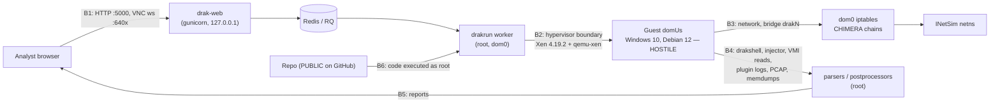

# CHIMERA Threat Model

**Version:** 1.1 (2026-10-21) · **Scope:** the single-host CHIMERA deployment (Xen dom0 + DRAKVUF + drakrun + web UI, a Windows 10 and a Debian 12 guest) used for the capstone evaluation.
**Status of controls** is marked **[in place]**, **[planned]** (in `containment-proposal.md`), or **[gap]** (accepted or out of scope). Evidence references point to `RECON-2026-10-19.md` (workspace root) and source lines in this repo.

CHIMERA deliberately executes hostile code. The platform is therefore itself a security-sensitive system: **assume every byte the guest produces is attacker-controlled, and assume the guest is fully compromised from the first instruction of the sample.**

---

## 1. System and trust boundaries

| ID | Boundary | Crossed by |
|---|---|---|
| B1 | Analyst ↔ web/API | HTTP 5000, VNC websocket 640x, `/rq` dashboard |
| B2 | Guest ↔ hypervisor/dom0 | Hypercalls, emulated devices in qemu-xen, altp2m/VMI |
| B3 | Guest ↔ network | Bridge `drakN`, NAT/forwarding, DNS, DHCP |
| B4 | Guest data ↔ dom0 processing | drakshell output, PERDEDOR/al-khaser JSON/logs, DRAKVUF logs, PCAP, dumps |
| B5 | Artefacts ↔ analyst | HTML reports, downloadable samples/dumps |
| B6 | Source/config ↔ privileged execution | Who can change code that runs as root |

## 2. Assets

1. **dom0 / host integrity**: root on dom0 equals control of Xen, all guests, and the laptop. The personal NVMe is physically present.
2. **Home/campus LAN and third parties on the Internet**: must not be attacked, scanned or spammed from a guest.
3. **Evidence integrity**: telemetry, PCAPs and reports must be attributable to the right analysis and not forgeable by the sample.
4. **Samples**: live malware at rest (`/var/lib/drakrun/uploads`, analysis dirs).
5. **Golden image and snapshot** (`vm-0.img`, `snapshot.sav`): corruption invalidates every later result.
6. **Credentials**: VNC password (`/etc/drakrun/install.json`), GitHub token (keyring), any TI API keys.
7. **Availability for the 31 Oct demo.**

## 3. Adversaries

| A | Adversary | Capability assumed |
|---|---|---|
| A1 | Malware sample in the guest | Kernel-level control of the guest; arbitrary network traffic; arbitrary output to any channel CHIMERA reads; knowledge of sandbox evasion |
| A2 | Network peer on the same LAN/Wi-Fi | Can reach any port the host listens on `0.0.0.0` |
| A3 | Compromised INetSim service | Code execution as the INetSim process user after a guest exploits it |
| A4 | Malicious or careless submitter/analyst | Uploads crafted files, triggers many jobs, opens hostile reports |
| A5 | Supply chain / public-repo reader | Reads everything committed; may submit hostile PRs or dependency updates |

Out of scope: hardware/firmware attacks, hypervisor 0-days by well-resourced actors (acknowledged as residual), physical theft.

## 4. Threats, controls, gaps

### T1 Guest-to-host escape (A1 → B2)
- **Vector:** bugs in Xen, the qemu-xen device model (an HVM device model running in dom0), emulated devices (e1000, stdvga, HDA audio, USB tablet), or DRAKVUF/LibVMI parsing guest memory.
- **Controls:** HVM with HAP [in place]; no PCI passthrough [in place].
- **Gaps:** device model not deprivileged or stub-domain'd [gap, evaluate `device_model_user`]; unneeded devices enabled (HDA audio, USB) [planned: removed in the M4 hardening profile]; Xen 4.19.2 patch level not yet checked against XSAs [gap, check].
- **Residual:** a hypervisor 0-day isn't mitigable at capstone scale. Mitigation is blast-radius reduction (T2, T7) and minimising sensitive data reachable from dom0.

### T2 Network escape / attacks on third parties (A1 → B3)
- **State on 2026-10-19 (fixed since):** drakrun's default networking masqueraded guests through the Wi-Fi, so guests could reach the Internet and the LAN.
- **Controls in place:** INetSim in an isolated network namespace; all guest IPv4 DNAT'ed to INetSim; a `CHIMERA_GUARD` FORWARD chain at position 1 that fails closed; IPv6 dropped on `drak+`; reverse-path filtering against spoofed sources; guest → dom0 INPUT dropped except DHCP; inter-bridge forwarding dropped; every analysis worker refuses to start unless `chimera-net-check --require-inetsim` passes. Verified by tests C-1 to C13 on 2026-10-19, all passed, including deliberate fail-closed cases (`containment-results-2026-10-19.md`).
- **Operational:** Wi-Fi off and no cable during real-sample batches.
- **Residual:** covert channels through timing/telemetry aren't addressed. INetSim's canned responses can reveal a fake Internet (an evasion concern, not a containment one).

### T3 INetSim compromise and pivot (A3)
- **Vector:** INetSim (Perl) parses hostile protocol traffic.
- **Controls in place:** it runs inside its own network namespace whose only link is a veth to dom0; FORWARD and INPUT drop anything the namespace initiates (test C9); its services run as the unprivileged `inetsim` user with no capabilities and NoNewPrivs (test C13).
- **Residual:** a namespace shares the dom0 kernel, so a kernel exploit from INetSim reaches dom0. A separate domU would be stronger, but free RAM (~5.6 GiB) doesn't allow it alongside the Windows guest.

### T4 Hostile guest output parsed as root (A1 → B4)
- **Vector:** drakshell stdout/stderr, PERDEDOR JSON, al-khaser logs, DRAKVUF plugin logs (strings come from guest memory), memdumps, PCAPs (packet dissectors are a classic attack surface).
- **Gaps (verified in review):** unbounded guest stdout accumulation (`drakrun/evasion/guest_runner.py:234`); whole-file reads before JSON parsing (`drakrun/evasion/verifiers/perdedor.py:247`); PERDEDOR `summary.weighted_score` inserted unescaped into its native HTML (`perdedor/common/python/perdedor_common/report.py:100`); validation doesn't check the expected check inventory, so a forged report can score high (`drakrun/evasion/scoring.py:108`, `perdedor_common/validation.py:25`).
- **In place:** an 8 MiB cap on guest command output streams (`guest_runner.py`, `MAX_STREAM_BYTES`).
- **Planned:** byte caps on the remaining guest-sourced files; schema plus expected-inventory validation; HTML escaping; treat a non-zero tool exit as not-OK.
- **Rule:** never open PCAPs or dumps with desktop tools on dom0 as root. Analyse copies as an unprivileged user.

### T5 Evidence integrity / spoofing (A1, A4 → asset 3)
- **Gaps:** "finished" doesn't imply complete telemetry, because the DRAKVUF return code is unchecked and postprocess errors are swallowed (`drakrun/analyzer/analyzer.py:395`, `drakrun/analyzer/postprocessing/postprocess.py:32`); analysis and evasion workers can target the same VM (`drakrun/evasion/worker.py:86` vs `drakrun/analyzer/worker.py:164`); `evasion.json` keeps "started" (`drakrun/evasion/worker.py:300-342`).
- **In place:** each analysis records `metadata.telemetry` (DRAKVUF return code, hard timeout, VM stall, per-plugin produced / missing status), and the evaluation excludes runs whose telemetry is incomplete.
- **Planned:** per-VM lock; record image hash, config hash and plugin list in each analysis's metadata; SHA-256 manifest of artefacts at completion.

### T6 Web/API and management exposure (A2, A4 → B1)
- **Controls in place (checked 2026-10-21):** the web UI/API, VNC and its websocket listen on 127.0.0.1 only; no TCP port listens on any other address; the system dnsmasq is disabled (drakrun's per-VM DHCP listens only on the guest bridge).
- **Gap:** the API, `/rq` dashboard and VNC have no app-level authentication; acceptable because they are reachable only from the host itself.
- **Residual:** any local user on dom0 can use the UI. For the capstone that is the single operator.

### T7 Privilege escalation through orchestration (A4, A5 → B6)
- **Vector:** a root worker importing code from a user-writable tree (`/home/shreyas/...`) means anything that can write as the user can get root.
- **In place:** the root workers run from a root-owned deployment (`/opt/chimera/src`, `/opt/chimera/venv`), never from the editable dev tree.
- **Planned:** pin dependencies; review submodule bumps.
- **Repo is PUBLIC:** never commit samples, private-source sample hashes, credentials, VNC passwords, `/etc/drakrun/*.json`, analysis outputs, or internal network details.

### T8 Resource exhaustion (A1, A4)
- **Vector:** disk-filling inside the guest (grows the qcow2 overlay on dom0), large memdumps, log floods, many uploads.
- **Current state:** 774 GiB free; drakrun data 32 GiB; no quotas.
- **Planned:** per-analysis size check; upload size limit; one job at a time per VM (one RQ worker per VM is already serial); disk usage tracked in the benchmark harness.

### T9 Crash, partial teardown and corrupted overlays (A1, operational)
- **Gaps:** restore failure happens before the cleanup `try/finally` (`drakrun/analyzer/run_tools.py:130`), and 3/8 historical runs failed restore. Network state is saved late, so leftover bridges/rules can survive. A hard-killed worker leaves a domain running.
- **Planned:** move restore inside cleanup; startup reconciliation (destroy stray `vm-N`, delete stray `drakN`, assert `CHIMERA_GUARD` exists before accepting jobs); the recovery procedure in §6.
- **Golden image:** `vm-0.img` is only ever a backing file. Keep an offline copy and a SHA-256 of `vm-0.img` and `snapshot.sav`, and verify before each experiment batch.

### T11 Linux samples on a Linux host (A1, asset 1)
- **Vector:** dom0 also runs Linux, so a Linux (ELF) sample could run on the host if it were ever executed outside the guest, e.g. by opening or extracting it on dom0.
- **Controls in place:** samples stay in MalwareBazaar's encrypted archives in a root-only folder; the evaluation runner decrypts each in memory, checks its SHA-256 and submits it straight to the guest; nothing on dom0 executes it; the Linux guest runs as its own HVM domain behind the same network containment as Windows (rule 4 below).

### T12 Static analysis parses hostile files on dom0 (A1, A4 → B4, asset 1)
- **Vector:** the static analyzer (`static_analyzer/chimera_static`) parses every upload with pefile, pyelftools, libmagic, YARA, signify and thrember. A parser bug (memory corruption in a C library, a decompression bomb, a crafted PE that sends pefile into a long loop) runs inside a process on the Xen dom0.
- **Decision: container, not VM.** The analyzer only reads the file and needs no hypervisor features; a Xen domU would compete with analysis VMs for memory and add a file-transfer channel. Risk level stays where dom0 already is (it runs capa on memory dumps and parses PCAPs). Upgrade path: gVisor (`--runtime runsc`) or a dedicated domU.
- **Controls in place (`drakrun/analyzer/static/sandbox.py`, verified 2026-10-23 by trying each escape from inside the container):** `--network none` (connect and DNS blocked); `--read-only` root; `--cap-drop ALL` (CapEff 0); `no-new-privileges`; uid/gid 65534; `--pids-limit 32`; memory = swap = 2 GiB; 1 CPU; `nofile` 256; no core dumps; `/tmp` tmpfs `noexec,nosuid,nodev`; sample mounted read-only (`noexec` on Podman); wall-clock kill after timeout + 30 s. In-process (`chimera_static/safety.py`): RLIMIT_AS, RLIMIT_CPU, RLIMIT_NPROC = 0 (no new process or thread after start-up), RLIMIT_FSIZE, `PR_SET_NO_NEW_PRIVS`, not dumpable, `O_NOFOLLOW` regular-file-only open.
- **Samples are never executable on the host:** uploads are chmod `0400` right after saving (`drakrun/web/api.py`); the static copy is `0440 root:65534` and deleted after the run; the analyzer never executes, imports or loads the sample.
- **Output:** the worker accepts only `static.json` (≤ 32 MiB, no symlink, schema `chimera-static/1`) and never parses the sample itself.
- **Gaps:** Docker (development) cannot mount the sample `noexec` (mode bits still forbid execution); the image is not yet built reproducibly with pinned hashes; no seccomp profile tighter than the engine default.

### T10 Thermal / hardware availability (operational)
- Sustained analyses raise temperatures. The fan daemon (`acer-fan-control.service`) depends on an out-of-tree kernel module that breaks on kernel updates (seen 2026-10-19). Check `systemctl is-active acer-fan-control` before long batches.

## 5. Malware handling rules (for the real-sample evaluation)

1. Real samples run only after containment tests C1–C8 pass on the same boot, with PCAP evidence saved.
2. Samples are stored as password-protected archives outside the repo; only the analysis copy is unpacked by the worker.
3. Each sample's source, SHA-256, retrieval date and family label (if known) go in a private register, not the public repo.
4. No sample is opened on dom0 outside the worker.
5. The project owner (and mentor, if institute policy requires) approves the sample set before detonation.
6. Retention: delete samples and dumps after the evaluation unless needed; keep hashes and derived telemetry.

## 6. Containment-failure response

If a guest is seen reaching anything other than INetSim (the `CHIMERA-EGRESS` drop log fires, or packets from 10.13.0.0/16 appear on the Wi-Fi interface):
1. `xl destroy` every analysis domain, then take the Wi-Fi interface down.
2. Save `iptables-save`, `ip -d link`, the analysis directory and its PCAP to an evidence folder.
3. Don't restart the worker until the rule set is re-verified with C1–C8.
4. If dom0 compromise is suspected (unexpected processes, modified binaries), stop using the boot, keep the disk for analysis, and reinstall dom0 from a known-good state.

## 7. Review log

| Date | Change | By |
|---|---|---|
| 2026-10-19 | Initial version from the Phase-1 recon and code review | Group 3 |
| 2026-10-21 | v1.1: containment, INetSim isolation, localhost-only services and root-owned deployment marked in place after checking the live host; Linux guest added (T11) | Group 3 |
| 2026-10-23 | v1.2: static analysis in a locked-down container (T12); uploads made non-executable | Group 3 |
